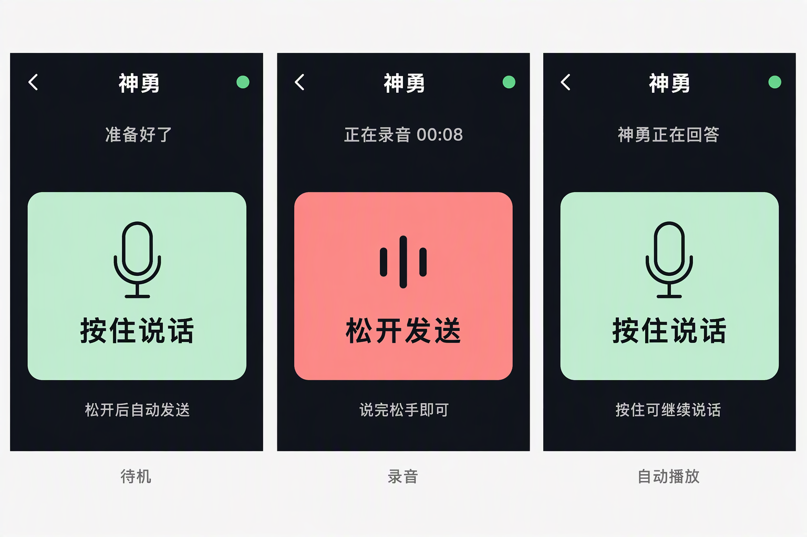

# 神勇设备升级（2026-10-13）

当前固件版本：2.2.6。目标设备为 Waveshare ESP32-C6 Touch AMOLED 2.16。

## 最终交互

- 选择器入口为 Shenyong AI，页面显示神勇。按住大按钮录音、松手自动入队发送。
- 前一条上传、等待模型或接收回复期间可继续录音；独立在途队首避免串单。
- 回复完整校验并落卡后自动播放。录音优先，按住时停止扬声器；松手后从保留的位置续播。
- 息屏时长按任意位置 300 ms 可录音，松开发送且不亮屏。KEY/GPIO10 也支持按住说话。
- PWR 只切换亮暗；进行中的触摸录音在两种触摸处理器之间交接，KEY 与触摸重叠时，最后一个按住来源释放才结束。
- BOOT 单击降低播放音量、双击提高。左上角返回键仍需长按 2 秒。
- 历史入口、列表、装饰圆球、独立暂停/继续按钮全部移除。

## 视觉设计

使用个人 imagegen 技能，通过 Azure 0932 / gpt-image-2 生成三状态设计方向，
实际图片为 1536×1024。按设备 480×480 画布重排后以静态 LVGL 对象实现：
深色背景、薄荷绿大按钮、珊瑚红录音态，24 px 文案和 36 px 品牌/按钮字体。
生成图是设计参考，不是实机截图；设备不加载大幅位图。

原始提示词见 [shenyong-ui-prompt.txt](images/shenyong-ui-prompt.txt)。

## 接入和数据边界

线上仅将既有小智 Identity 改绑到康宁，复用现有神勇助手。Android 用户和金山助手保持原样。
硬件 Token、full 上下文策略与康宁默认主动发送目标未改动；旧生产消息和 turn 归属不迁移。
新本地数据使用 `/sdcard/shenyong/`，旧金山目录保留且不展示、不自动重放。
未校时时存储层接受精确 `unsynced`，离线录音可保存和重启恢复。

## 验证

- 16 组 C++ 主机测试通过，涵盖状态机、队首不被新录音覆盖、FATFS 发布、回复接收时追加录音、播放器跨录音精确续读、暗屏门槛与双输入交接，以及离线目录恢复。
- 2 项运行日志判定测试通过；ESP-IDF 5.5.3 / esp32c6 完整构建通过。
- USB 读取并保留升级前 16 MiB Flash 备份；分区表一致，确认 active ota_0 后仅烧录 0x20000 的 app，未擦除 NVS、未修改 OTA data、bootloader 或 assets。
- 实机已验证启动、SD 初始化、ESP-SR 降噪启用和 Wi-Fi 获得地址；修复初轮上传临时数组导致的 main 栈保护错误后，后续观察无重复重启。
- 服务端绑定已核验，SQLite quick_check=ok、外键违规=0；同一设备凭据在电脑端访问生产 WSS 返回 HTTP 101 和 protocol 1 ready。

## 当前明确限制

办公 Wi-Fi 路径返回 TLS 1.0 ServerHello（0x0301），固件要求 TLS 1.2（0x0303），
因此返回 MBEDTLS_ERR_SSL_BAD_PROTOCOL_VERSION。主域名与平台现有兼容域名对照结果相同；
电脑端和服务器侧正常 TLS 1.2 核验通过。用户已明确选择保留办公网络并完成当前版本。
最终固件恢复原 Agent 域名和正常 TLS 配置，不保留备用域名硬编码或调试日志。

所以完整设备→模型→回复自动播放，以及真实连续两条和息屏语音回路，仍需更换网络后验收。
主机测试通过不等同于这些真实回路已通过；本次未降级 TLS、关闭证书校验或改动生产 Nginx。
